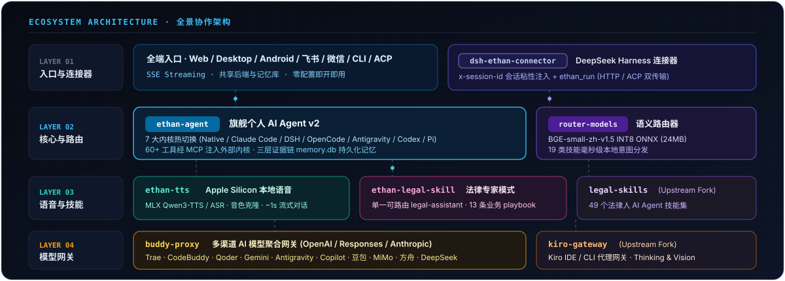

<div align="center">

<a href="https://github.com/orgs/llm011/repositories">
  
</a>

<br/><br/>

<!-- Quick Navigation Badges -->
<a href="https://github.com/llm011/ethan-agent"></a>
<a href="https://github.com/llm011/buddy-proxy"></a>
<a href="https://github.com/llm011/ethan-tts"></a>
<a href="https://github.com/llm011/dsh-ethan-connector"></a>
<a href="https://github.com/orgs/llm011/repositories"></a>

<br/>

**构建真正好用的个人 AI 基础设施：多内核个人 Agent · 统一模型协议网关 · Apple Silicon 本地语音 · DSH 生态连接器**

</div>

---

## 🗺️ 核心协作架构 · Ecosystem Architecture

<div align="center">
  
</div>

> 各项目既可**独立部署运行**，也可无缝串联为完整的个人 AI 工作流：
> 全端入口 / [DeepSeek Harness](https://github.com/llm011/dsh-ethan-connector) ➔ [Ethan Agent](https://github.com/llm011/ethan-agent)（多内核编排 · 工具 · 记忆 + [本地语音](https://github.com/llm011/ethan-tts)）➔ [Buddy Proxy](https://github.com/llm011/buddy-proxy) 多渠道模型网关。

---

## 🚀 主力项目 · Featured Projects

<table>
<tr>
<td width="50%" valign="top">

### 🤖 [ethan-agent](https://github.com/llm011/ethan-agent)

[](https://github.com/llm011/ethan-agent/stargazers)
[](https://github.com/llm011/ethan-agent)
[](https://pypi.org/project/ethan-agent/)

> **多内核驱动的轻量高性能个人 AI Agent**

- 🧠 **7 大内核热切换**：原生 Ethan 内核，或将执行权交给 `Claude Code` / `DSH` / `OpenCode` / `Antigravity` / `Codex` / `Pi`，并通过 MCP / ACP 无污染注入 58+ 工具
- 🧬 **证据链记忆体系**：`memory.db` 区分 `explicit` / `observed` / `corrected`，带原文 quote 佐证与语义召回
- 🌐 **全端覆盖**：Web · Tauri 2 Desktop · Android · 飞书 · 微信 · CLI REPL · ACP · Docker / NAS 一键部署

👉 **[查看仓库](https://github.com/llm011/ethan-agent)** · **[Releases](https://github.com/llm011/ethan-agent/releases)**

</td>
<td width="50%" valign="top">

### 🌐 [buddy-proxy](https://github.com/llm011/buddy-proxy)

[](https://github.com/llm011/buddy-proxy/stargazers)
[](https://github.com/llm011/buddy-proxy)
[](https://github.com/llm011/buddy-proxy)

> **多渠道订阅与模型统一协议网关（单端点按模型名路由）**

- 🔌 **多通道接入**：CodeBuddy · Trae · Qoder · Gemini · Antigravity · GitHub Copilot · 豆包 · 小米 MiMo · 火山方舟 · GLM · DeepSeek 等
- 🔄 **三协议互通 & 多账号容灾**：标准转换 `/v1/chat/completions`、`/v1/responses`、`/v1/messages`，自动 401/429 冷却切换
- 📊 **Web 控制台 & CLI**：`/ui` 配额看板、一键测试、模型隐藏/禁用、`buddy usage / logs / doctor` 终端运维

👉 **[查看仓库](https://github.com/llm011/buddy-proxy)** · **[中文文档](https://github.com/llm011/buddy-proxy/blob/main/README_zh.md)**

</td>
</tr>
<tr>
<td width="50%" valign="top">

### 🎙️ [ethan-tts](https://github.com/llm011/ethan-tts)

[](https://github.com/llm011/ethan-tts/stargazers)
[](https://github.com/llm011/ethan-tts)
[](https://github.com/llm011/ethan-tts)

> **运行在 Apple Silicon 上的本地 Qwen3-TTS 工作台 & 实时语音对话**

- ⚡ **纯本地 MLX 推理**：无需 NVIDIA 显卡或 Docker，默认 Qwen3-TTS 0.6B 4bit + Qwen3-ASR 0.6B（热态识别 ~0.2s）
- 🗣️ **实时全双工语音对话（`/chat`）**：流式切句边生成边播，首句约 1s 出声，支持随时打断与手机端访问
- 🎛️ **专业音色工作台**：9 种内置音色、文字设计声音、参考录音克隆、0.5×–2.0× 保音高变速与读音纠正词典

👉 **[查看仓库](https://github.com/llm011/ethan-tts)**

</td>
<td width="50%" valign="top">

### 🔌 [dsh-ethan-connector](https://github.com/llm011/dsh-ethan-connector)

[](https://github.com/llm011/dsh-ethan-connector/stargazers)
[](https://github.com/llm011/dsh-ethan-connector)
[](https://github.com/llm011/dsh-ethan-connector)

> **DeepSeek Harness (DSH) 与 Ethan Agent / 网关的双向桥梁**

- 🪪 **自动会话粘性注入**：监听 `llm-pi-ai/request-headers` 自动注入 `x-session-id`，配合 `buddy-proxy` 实现同会话账号亲和与跨会话轮询
- 🛠️ **`ethan_run` 工具**：优先通过 HTTP 调用运行中的 Ethan 服务（复用记忆与配置），不可达时自动降级为 `ethan acp` stdio JSON-RPC
- 🖥️ **TUI & Web 双端兼容**：通过标准 `GenericCallView` / `GenericResultView` 清晰呈现 Ethan 的工具步骤与最终结果

👉 **[查看仓库](https://github.com/llm011/dsh-ethan-connector)**

</td>
</tr>
</table>

---

## ⚡ 10 秒上手 · Quick Start

<details>
<summary><b>🤖 启动 Ethan Agent（个人 AI 主控端）</b></summary>

```bash
pip install ethan-agent

# 交互式命令行 REPL / 单轮执行
ethan
ethan -p "帮我看下这个仓库的结构"

# 启动 Web 与 API 服务 (默认端口 8900)
ethan serve
```

</details>

<details>
<summary><b>🌐 启动 Buddy Proxy（统一模型网关）</b></summary>

```bash
git clone https://github.com/llm011/buddy-proxy.git
cd buddy-proxy && uv sync

./buddy start              # 启动网关并打开 http://127.0.0.1:8787/ui
./buddy login trae         # 登录上游渠道
./buddy usage              # 查看全渠道账号配额与状态
```

</details>

<details>
<summary><b>🎙️ 启动 Ethan TTS（Apple Silicon 本地语音工作台）</b></summary>

```bash
git clone https://github.com/llm011/ethan-tts.git
cd ethan-tts
# 安装依赖并启动 Web 服务 (默认端口 8765，语音对话页 /chat)
python app.py
```

</details>

---

## 🛠️ 技术栈 · Tech Stack

<div align="center">


<br/><br/>

<a href="https://github.com/orgs/llm011/repositories">
  
</a>

<br/>

<sub>探索更多仓库与上游镜像：<a href="https://github.com/orgs/llm011/repositories">github.com/orgs/llm011/repositories</a></sub>

</div>
